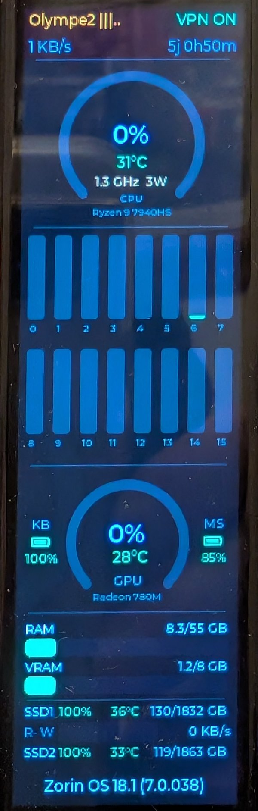
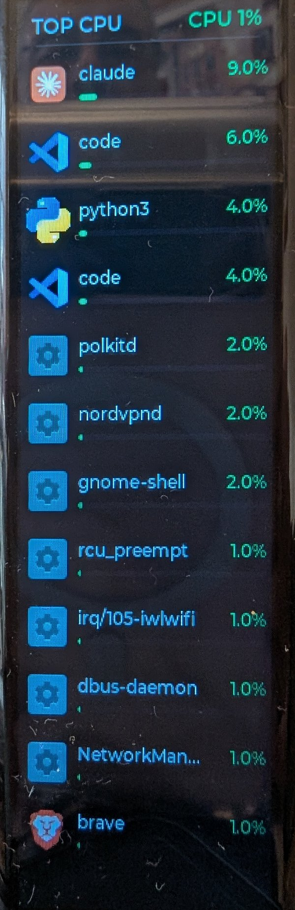

# NUC Monitor — T-Display-S3-Long

[🇬🇧 English](README.md) | 🇫🇷 Français

> Fork de [Xinyuan-LilyGO/T-Display-S3-Long](https://github.com/Xinyuan-LilyGO/T-Display-S3-Long) : les exemples et bibliothèques LilyGo d'origine sont conservés dans `examples/` et `lib/`, le moniteur NUC se trouve dans `examples/sys_monitor/` et `tools/`.

Moniteur système graphique pour NUC AMD (Ryzen 9 7940HS + Radeon 780M) affiché sur un écran T-Display-S3-Long (ESP32-S3, 180×640 px portrait).

Les métriques sont envoyées du NUC vers l'ESP32 via USB-Serial (CSV) par le script Python `tools/monitor_sender.py`. Un second écran, affiché d'un toucher ou avec le bouton BOOT, montre le top 12 des processus avec l'icône de leur appli (voir [Écran 2 — Top processus](#écran-2--top-processus)).

<p align="center">
  
  &nbsp;&nbsp;
  
</p>
<p align="center"><em>Écran 1 : métriques système · Écran 2 : top processus</em></p>

---

## Hardware

### Carte

| Élément | Détail |
|---------|--------|
| Carte | LILYGO T-Display-S3-Long, révision datée du **20-06-2026** (tactile CST3530) |
| SoC | ESP32-S3R8 : double cœur Xtensa LX7 à 240 MHz, 512 Ko de SRAM, Wi-Fi 2,4 GHz et Bluetooth LE |
| PSRAM | 8 Mo OPI, intégrée au boîtier (le « R8 » de ESP32-S3R8) |
| Flash | 16 Mo QIO à 80 MHz, partitionnée en `huge_app.csv` (3 Mo d'application) |
| Écran | 180×640 px, contrôleur **AXS15231B** en QSPI à 32 MHz, rétroéclairage PWM |
| Tactile | **CST3530** (Hynitron), I2C, puce séparée de l'écran |
| Charge batterie | **BQ25896** (Texas Instruments), I2C `0x6A` |
| USB | Type-C, USB-Serial-JTAG natif de l'ESP32-S3 (VID:PID `303A:1001`), vu en `/dev/ttyACM0` |
| Boutons | BOOT (GPIO0, utilisé comme bascule d'écran) et RST |

### Brochage utilisé (`pins_config.h`)

| Fonction | GPIO |
|----------|------|
| Écran QSPI : CS / SCK | 12 / 17 |
| Écran QSPI : D0 / D1 / D2 / D3 | 13 / 18 / 21 / 14 |
| Écran : reset | 16 |
| Rétroéclairage (LEDC canal 0, 5 kHz) | 1 |
| I2C (tactile + BQ25896) : SDA / SCL | 15 / 10 |
| Tactile : INT / reset | 11 / 2 |
| Bouton BOOT | 0 |

### Révisions du tactile

LilyGo a changé de contrôleur tactile en cours de production, sans changer le nom de la carte. Le code de la nouvelle révision a été publié le 19-05-2026 :

| Révision | Contrôleur tactile | Adresse I2C | Reset tactile | Code LilyGo |
|----------|--------------------|-------------|---------------|-------------|
| Ancienne révision | Intégré à l'AXS15231B | `0x3B` | GPIO16 (partagé avec l'écran) | branche `master`, exemple `touch` |
| Révision CST3530 (cette carte) | **CST3530** séparé | `0x58` (`0x5A` en bootloader) | **GPIO2** | branche `T-Display-S3-Long-cst3530`, exemple `cst3530_touch` |

Ce projet ne gère que la révision CST3530. Les exemples LilyGo de `examples/` (`factory`, `lvgl_demo`, `TFT`, `QWIIC_Sensor`, `cst3530_touch`) sont repris de la branche `T-Display-S3-Long-cst3530` (synchronisés le 23-10-2026) et visent cette révision. Seul `GFX_AXS15231B_Image`, identique dans les deux branches, interroge encore l'ancien tactile.

Pour remettre le firmware d'usine, recompiler l'exemple `factory` (il hérite de `HYN_POWER_ON_UPDATA = 0`) plutôt que flasher le `factory-cst3530.bin` précompilé de LilyGo, non repris ici. Ce binaire est compilé avec `HYN_POWER_ON_UPDATA = 1` : son firmware tactile embarqué a la même version que celui de la puce de cette carte (`1010001`), il ne devrait donc pas la reprogrammer, sauf si la puce avait une version plus ancienne ou un démarrage en échec.

La CST3530 de cette carte s'identifie ainsi au démarrage (messages `[HYN]` du pilote sur le port série) : `ictype:caca220e`, `fw_project_id:2601093`, firmware de la puce `fw_ver:1010001`.

Elle est pilotée par le pilote Hynitron fourni par LilyGo (`lib/hyn_driver_for_esp32`), avec **`HYN_POWER_ON_UPDATA = 0`** dans `hyn_cfg.h`. Le pilote ne reprogramme donc jamais le firmware interne de la puce tactile : l'original ne peut pas être sauvegardé, et une mise à jour serait irréversible. Ne passer cette valeur à `1` qu'en connaissance de cause.

### Environnement de build testé

| Élément | Version |
|---------|---------|
| Plateforme PlatformIO | `espressif32` 7.0.1 (figée dans `platformio.ini`) |
| Framework | Arduino-ESP32 2.0.17 (ESP-IDF 4.4) |
| LVGL | 8.3.0-dev, fournie dans `lib/lvgl` |
| Pilote tactile | Hynitron V2.10 (20241111), fourni dans `lib/hyn_driver_for_esp32` |

Le pilote Hynitron est écrit pour ESP-IDF 4.4 (ancien driver I2C, types FreeRTOS d'avant IDF 5) : passer à Arduino-ESP32 3.x demanderait de l'adapter. Il partage le port I2C 0 déjà installé par `Wire`, d'où le message `E (799) i2c: i2c driver install error` au démarrage, sans conséquence.

---

## Layout de l'écran

```
┌──────────────────────────────────────┐
│ WifiSSID |||..                VPN ON │  ← ligne 1 : SSID + barres (font_12) | VPN (font_12)
│ 512 KB/s                     14h 9m  │  ← ligne 2 : débit réseau (font_12) | uptime (font_12, `4j 16h9m` au-delà d'un jour)
├──────────────────────────────────────┤  ← séparateur header / CPU
│         Arc CPU  %  °C               │  ← CPU % (font_20) + °C, couleur dynamique
│          3.2 GHz  45W                │  ← fréquence CPU + puissance du package (font_10, orange doux, centrées ; `45W` masqué si `CPWR = 0`)
│     CPU  ·  Ryzen 9 7940HS           │  ← labels fixes (font_8)
├──────────────────────────────────────┤
│  Barres 16 cœurs (0-7 / 8-15)        │  ← 2 rangées × 8, numéros colorés sous chaque barre
├──────────────────────────────────────┤
│  KB      Arc GPU  %  °C       MS     │  ← GPU % + °C (Radeon 780M) ; piles clavier (gauche) / souris (droite)
│ [▮▮▮]       GPU              [▮  ]   │  ← "GPU" + "Radeon 780M" dessous ; icône pile colorée
│ 100%                          20%    │  ← % pile : vert ≥ 60, jaune ≥ 35, orange ≥ 15, rouge < 15
├──────────────────────────────────────┤
│ RAM          14/62 GB                │  ← Label gauche, valeur droite, barre dessous
| [════════]                           |
│ VRAM          1/8 GB                 │  ← Idem, VRAM iGPU
| [════════]                           |
├──────────────────────────────────────┤
│ SSD1 100%  38°C          123/1832 GB │  ← Titre SSD1, santé SMART, temp. centrée, capa. droite
│  R - W  [══════]             16 KB/s │  ← R et W en vert si actifs (> 512 KB/s), gauge centrée entre les 2 textes
│ SSD2 100%   32°C           480/1863GB│  ← ligne partagée : SSD2 (santé+temp.+capa.) si UPD == 0, sinon nombre de maj disponibles
│                                      │
│      Zorin OS 18.1 (6.17.040)        │  ← ligne de statut (bas d'écran) : OSKV si connecté, sinon "En attente du PC..."
└──────────────────────────────────────┘
```

> La ligne SSD2 ci-dessus n'est visible que quand `UPD == 0` (aucune mise à jour dispo) — sinon cette même ligne affiche `N maj disponibles` (orange, centré). Si la santé SSD2 est indisponible (`S2HLTH = 255`) et qu'il n'y a pas de mise à jour, la ligne reste vide.

**Couleurs dynamiques** (tous les widgets) :
- Pourcentage : < 50 % → vert · < 70 % → jaune · < 85 % → orange · ≥ 85 % → rouge
- Température CPU/GPU : < 60 °C → vert · < 75 °C → jaune · < 85 °C → orange · ≥ 85 °C → rouge
- Signal WiFi : ≥ 70 % → colore le SSID en vert · ≥ 40 % → orange · < 40 % → rouge
- VPN : actif → vert · inactif → gris (compatible avec la plupart des VPN du marché, voir [Détection du VPN](#détection-du-vpn))
- % CPU et GPU : affichés en bleu (`CLR_GPU`)
- Fréquence + puissance CPU (`3.2 GHz  45W`) : orange doux fixe (`0xE0A060`), volontairement plus terne que l'orange des seuils (`0xFF8C00`) pour ne pas passer pour une alerte
- Numéros de cœurs : colorés selon leur activité (même couleur que la barre, > 5 %)
- Santé SMART SSD : ≥ 90 % → vert · ≥ 70 % → orange · < 70 % → rouge

---

## Structure du projet

```
examples/sys_monitor/
├── sys_monitor.ino     # Boucle principale (setup/loop)
├── ui.h / ui.cpp       # Interface LVGL (init + update, écran 2 top processus)
├── serial_parser.h     # Parser non-bloquant (trames CPU:, P:, I:)
├── icon_cache.h / .cpp # Cache PSRAM des icônes d'applis (écran 2)
├── touch_cst3530.h / .c # Enveloppe du pilote tactile Hynitron (CST3530)
├── AXS15231B.h / .cpp  # Driver écran QSPI (DMA, veille lcd_sleep/lcd_wake)
└── pins_config.h       # Brochage (écran, tactile, BOOT) et résolution

tools/
├── monitor_sender.py       # Script Python NUC → ESP32
├── proc_top.py             # Top 12 processus + icônes d'applis (écran 2)
├── nuc-monitor.service     # Modèle de service systemd
├── install-autostart.sh    # Script d'installation autostart pour linux
├── dev-mode.sh             # Arrête/relance le service pour développement ESP32
└── deploy.sh               # Déploiement complet : arrêt → flash → redémarrage service

lib/
├── lv_conf.h              # Config LVGL (fonts activés)
├── lvgl/                  # LVGL 8.3
└── hyn_driver_for_esp32/  # Pilote tactile Hynitron/LilyGo (HYN_POWER_ON_UPDATA = 0)
```

Les autres dossiers de `examples/` et de `lib/` (`Arduino_GFX`, `Arduino_DriveBus`, `XPowersLib`) viennent du dépôt LilyGo d'origine et ne servent pas à `sys_monitor`. `examples/ESPHome_LVGL_HelloWorld/` est une configuration ESPHome (YAML), hors PlatformIO. La datasheet du CST3530 (en chinois) est dans `datasheet/`.

---

## Métriques envoyées (protocole CSV)

```
CPU:65,CTEMP:78,GPU:23,GTEMP:62,RAM:68,RTOT:62,
SREAD:51200,SWRIT:20480,STEMP:38,SCAP:123,STOT:1832,SHLTH:100,
S2TMP:32,S2CAP:480,S2TOT:1863,S2HLTH:100,
VUSED:1489,VTOT:8192,WNAM:Olympe,WSIG:56,VPN:1,
NTOT:512,CFRQ:32,CPWR:45,UPTS:50998,
OSKV:Zorin OS 18.1 (6.17.040),UPD:3,SCR:1,
KBAT:100,KCHG:0,MBAT:20,MCHG:0,
CX:55;12;8;6;4;3;2;1;78;45;12;8;5;3;2;1
```

| Clé | Valeur |
|-----|--------|
| `CPU` | % utilisation CPU global (entier), moyenne des 16 threads de `CX` |
| `CTEMP` | Température CPU °C (k10temp/Tctl, lu directement dans son fichier hwmon, entier) |
| `GPU` | % utilisation GPU (gpu_busy_percent sysfs, entier) |
| `GTEMP` | Température GPU °C (amdgpu/edge, entier) |
| `RAM` | % RAM utilisée (entier) |
| `RTOT` | RAM totale en GB (entier) |
| `SREAD` / `SWRIT` | Débit SSD1 (NVMe) lecture/écriture en **KB/s** (entier, précision sub-MB/s) |
| `STEMP` | Température SSD1 °C (sysfs nvme hwmon, entier) |
| `SCAP` / `STOT` | Espace utilisé / total SSD1 en GB |
| `SHLTH` | % de santé SMART SSD1 (`100 - percent_used`, via UDisks2/D-Bus, sans root). `255` = indisponible (pas de NVMe, ou D-Bus/UDisks2 absent) — non affiché sur l'écran dans ce cas |
| `S2TMP` | Température SSD2 °C. Pas de sysfs hwmon pour ce pont USB-SATA : lue via UDisks2/D-Bus (`Drive.Ata.SmartTemperature`, sans root). `0` si indisponible |
| `S2CAP` / `S2TOT` | Espace utilisé / total SSD2 en GB |
| `S2HLTH` | Santé SSD2 : `100` (vert, sain) / `20` (rouge, WARN — `SmartFailing`, attribut en échec, ou secteur défectueux) / `255` = indisponible. Pas de % d'usure fiable sur ATA générique (contrairement au NVMe), d'où un statut binaire affiché en valeurs symboliques. Affiché sur la ligne des mises à jour, uniquement quand `UPD == 0` ; avec `255`, toute la ligne SSD2 est masquée |
| `VUSED` / `VTOT` | VRAM utilisée / totale en MB (sysfs amdgpu) |
| `WNAM` | SSID WiFi (max 8 chars, sanitisé), lu sur D-Bus NetworkManager toutes les 5 s |
| `WSIG` | Qualité signal WiFi % (`AccessPoint.Strength` de NetworkManager, même valeur que `nmcli dev wifi`, rafraîchie toutes les 5 s) — colore le SSID et donne les 5 barres `\|\|\|..`, non affiché en chiffre |
| `VPN` | VPN actif : 1 / inactif : 0 (interface UP point-à-point ou nommée tun/tap/wg/vpn/nord, vérifiée 1×/s, voir [Détection du VPN](#détection-du-vpn)) |
| `NTOT` | Débit réseau total lissé en KB/s (upload + download, EMA α=0.25, interface WiFi) |
| `CFRQ` | Fréquence CPU moyenne × 10 (ex: `32` = 3.2 GHz, moyenne des `scaling_cur_freq` des 16 threads) |
| `CPWR` | Puissance du package APU en Watts (PPT amdgpu, sinon RAPL ; `0` = aucune source lisible → non affichée) |
| `UPTS` | Uptime système en secondes (`time.time() − psutil.boot_time()`) |
| `OSKV` | Nom OS + version + noyau tronqué, ex `Zorin OS 18.1 (6.17.040)` (max 40 chars, affiché sur la ligne du bas quand connecté) |
| `UPD` | Nombre de mises à jour dispo (`/var/lib/update-notifier/updates-available`, rafraîchi ~1-2x/jour par `apt-daily.timer` — pas temps réel). Ligne orange affichée uniquement si > 0 |
| `SCR` | État souhaité de l'écran ESP32 : `1` = allumé, `0` = veille (rétroéclairage coupé + AXS15231B en sleep). Absent → `1` |
| `KBAT` / `MBAT` | % pile clavier / souris (UPower via D-Bus système, sans root, rafraîchi toutes les 60 s). `255` = absent → colonne vide. Classement par nom de modèle (`K780`, `MX Anywhere`…) car UPower déclare la souris HID++ Logitech en type *keyboard* |
| `KCHG` / `MCHG` | `1` = périphérique en charge → icône éclair à la place de la pile |
| `CX` | 16 valeurs % par cœur séparées par `;` (ex: `CX:55;12;8;...;1`) |

> **Note SSD2** : les débits SSD2 (`S2RD`/`S2WR`) ne sont plus envoyés — le pont USB-SATA ASMedia ASM235C (driver `uas`) ne remonte pas les lectures dans `/proc/diskstats`. Le firmware ne les lit plus. SSD2 n'apparaît qu'à travers `S2HLTH`/`S2TMP`/`S2CAP`/`S2TOT`, sur la ligne partagée avec les mises à jour.

---

## Mesure de la puissance (wattage)

Le chiffre `nnW` affiché à côté de la fréquence, sous l'arc CPU, est la **puissance du package APU** (PPT, *Package Power Tracking*) : la puce Ryzen 9 7940HS entière.

| Compté | Non compté |
|--------|------------|
| 8 cœurs Zen 4 (16 threads) et leur cache L3 | RAM (barrettes DDR5) |
| iGPU Radeon 780M | SSD, WiFi, Ethernet, USB externes |
| SoC : contrôleur mémoire, PCIe/USB, moteur d'affichage, NPU… | Ventilateur, régulateurs de la carte mère, bloc secteur |

La consommation à la prise est donc plus élevée que ce chiffre (non mesurée ici).

**Source** : `power1_average` du hwmon amdgpu (label `PPT`, ex. `/sys/class/drm/card1/device/hwmon/hwmon7/power1_average`, en µW, chemin résolu au démarrage), lisible sans root. C'est une estimation calculée par le SMU (le microcontrôleur de gestion d'énergie du Ryzen), qui s'en sert lui-même pour appliquer ses limites de puissance et décider des fréquences turbo. Le script la lit à chaque trame (0,25 s), l'arrondit au watt et l'envoie dans `CPWR`.

**Lissage** : la valeur est moyennée par le SMU sur ~1 à 2 s. Elle met environ 2 s à suivre un changement brusque de charge (montée de 5 à 55 W en ~2,5 s). `power1_input` (valeur instantanée) n'est pas utilisée : elle retombe parfois à 0 W en pleine charge.

**Ordres de grandeur mesurés sur ce NUC** :

| Situation | `CPWR` |
|-----------|--------|
| Repos (bureau, écran allumé) | ~5–6 W |
| 8 threads CPU saturés | ~55–58 W |
| iGPU chargé (`glxgears` sans vsync, + CPU qui l'alimente) | ~50 W |

Le 7940HS est prévu pour 35–54 W en continu ; la valeur exacte et les pointes autorisées sont réglées par le fabricant du NUC dans le BIOS.

**Repli RAPL** : sans hwmon amdgpu, le script calcule la puissance à partir du compteur d'énergie RAPL (`/sys/class/powercap/intel-rapl:0/energy_uj`, domaine `package-0`, différence entre deux lectures). Ce compteur existe sur ce Ryzen (module `intel_rapl_msr`) mais n'est lisible que par root depuis les correctifs des attaques par canal auxiliaire Platypus (CVE-2020-8694 / CVE-2020-12912) : pour le service (qui tourne sous l'utilisateur de la session, pas root), il renvoie 0. Ne pas le rouvrir aux autres utilisateurs par une règle udev : PPT donne la même information sans affaiblir ce correctif.

**Pas de séparation CPU / iGPU** : ce Ryzen (Phoenix, SMU 13.0.4) n'a aucun capteur de puissance propre à l'iGPU. Le fichier `gpu_metrics` d'amdgpu publie la puissance par cœur (`CorePower[8]`) et deux rails : `VDDCR_VDD`, que le pilote range dans le champ `average_gfx_power` malgré son nom, et qui suit en fait la charge CPU (55 W sous une charge purement CPU, à peine plus que la somme des cœurs avec l'iGPU chargé) : ce n'est pas la puissance de l'iGPU ; et `VDDCR_SOC` (~1–2 W). « Total − cœurs » ne donnerait qu'une approximation (iGPU + L3 + SoC, ~5 W même au repos) : le total est donc affiché tel quel, sous l'arc CPU. En jeu ou en vidéo, il peut monter alors que le % CPU reste bas, parce que c'est l'iGPU qui consomme.

**Vérifier à la main** :
```bash
cat /sys/class/drm/card*/device/hwmon/hwmon*/power1_label     # doit afficher PPT
cat /sys/class/drm/card*/device/hwmon/hwmon*/power1_average   # µW (5100000 = 5,1 W)
sensors 'amdgpu-pci-*'                                        # ligne « PPT: 22.17 W (avg = 6.02 W) » : c'est avg qui est affiché
sudo journalctl -u nuc-monitor | grep Puissance               # source retenue au démarrage du service
```
Au démarrage, le preflight affiche `Puissance OK n W (<chemin>)`, ou `n/a` si ni PPT ni RAPL n'est lisible (l'écran n'affiche alors que la fréquence).

---

## Détection du VPN

L'indicateur `VPN` du bandeau est **compatible avec la plupart des VPN du marché** : il ne dépend ni du fournisseur ni de son application, mais de l'interface réseau que crée le tunnel.

**Règle** : le VPN est considéré actif dès qu'une interface réseau est UP et remplit l'une de ces conditions :
- elle porte le flag `pointopoint` (lien point à point). C'est le cas des tunnels WireGuard et OpenVPN (mode tun), qui sont les deux technologies utilisées par la quasi-totalité des VPN grand public sous Linux ;
- son nom contient `tun`, `tap`, `vpn`, `wg` ou `nord` (`_VPN_NAMES` dans `monitor_sender.py`). Ce filet couvre notamment OpenVPN en mode TAP, qui n'est pas point à point.

Les interfaces du réseau local (Ethernet, WiFi, `lo`) et les ponts de Docker ou libvirt n'ont pas ce flag : ils ne déclenchent pas l'indicateur.

| VPN / technologie | Interface typique | Détecté |
|-------------------|-------------------|---------|
| NordVPN, NordLynx (WireGuard) | `nordlynx` | ✅ testé (NordVPN 5.4.1) |
| NordVPN, OpenVPN | `nordtun` | ✅ |
| Mullvad, Proton VPN, Surfshark, PIA, ExpressVPN, CyberGhost, Windscribe, IVPN… (WireGuard ou OpenVPN) | `wg0-mullvad`, `proton0`, `tun0`… | ✅ attendu, non testé |
| WireGuard (`wg-quick`) ou OpenVPN configurés à la main ou dans NetworkManager | `wg0`, `tun0` | ✅ |
| VPN d'entreprise via OpenConnect (Cisco AnyConnect, GlobalProtect, Pulse) | `tun0`, `vpn0` | ✅ |
| FortiGate SSL-VPN (`openfortivpn`), L2TP | `ppp0` | ✅ |
| OpenVPN en mode TAP | `tap0` | ✅ (par le nom) |
| IPsec / IKEv2 natif (strongSwan, Libreswan) | aucune | ❌ ces VPN ne créent en général pas d'interface |

**Faux positifs connus** : une connexion PPPoE ou 4G (`ppp0`) et Tailscale (`tailscale0`) sont vues comme un VPN, même quand Tailscale ne sert pas de nœud de sortie. Ce cas ne se présente pas sur ce NUC.

**Coût** : aucun surcoût. Le script réutilise l'appel `net_if_stats()` (~0,14 ms) et n'ajoute qu'une comparaison de chaînes. Une détection par la route par défaut (`ip route get 1.1.1.1`), plus exacte, a été écartée : elle lance un processus à chaque test (~1,4 ms).

**Vérifier à la main** :
```bash
ip -br link                                                   # repérer l'interface du VPN (ex. nordlynx)
python3 -c "import psutil; print({k: v.flags for k, v in psutil.net_if_stats().items()})"   # doit contenir pointopoint pour elle
sudo journalctl -u nuc-monitor | grep VPN                     # ligne du preflight : « OK (actif) » ou « inactif »
```
Si un VPN n'est pas reconnu, ajouter un motif de son nom d'interface dans `_VPN_NAMES`.

---

## Installation

### Prérequis (démarrage rapide)

Testé sur Zorin OS 18 (base Ubuntu 24.04). Les étapes suivent celles du dépôt LilyGo d'origine, adaptées à Linux et à ce projet.

1. **Matériel** : une T-Display-S3-Long révision CST3530 (voir [Révisions du tactile](#révisions-du-tactile)) et un câble USB-C qui transporte les données (pas un câble de charge seule).
2. **Paquets de base** : `python3-venv` est nécessaire à l'installateur de PlatformIO.
   ```bash
   sudo apt install git python3-venv
   ```
3. **Accès au port série** (flash et service) : ajouter son compte au groupe `dialout`, puis se déconnecter et se reconnecter.
   ```bash
   sudo usermod -aG dialout $USER
   ```
4. **VS Code** : installer [Visual Studio Code](https://code.visualstudio.com/) (paquet `.deb`) ou `sudo snap install code --classic`.
5. **Extension PlatformIO IDE** : dans VS Code, onglet Extensions, chercher `PlatformIO IDE`, l'installer puis redémarrer VS Code. Elle installe PlatformIO Core dans `~/.platformio`, le chemin qu'utilise `tools/deploy.sh`.
6. **Cloner le projet** puis l'ouvrir dans VS Code (`Fichier` → `Ouvrir le dossier...`).
   ```bash
   git clone https://github.com/DDevfr/T-Display-S3-Long.git
   ```
7. **Premier chargement** : PlatformIO télécharge la plateforme `espressif32` et la chaîne Arduino-ESP32 (plusieurs minutes, une seule fois). LVGL et le pilote tactile sont déjà dans `lib/` : aucune bibliothèque à installer (versions dans [Environnement de build testé](#environnement-de-build-testé)).
8. **Compiler et flasher** : `sys_monitor` est déjà l'environnement par défaut de `platformio.ini` (pas de ligne à décommenter, contrairement au dépôt LilyGo). Brancher la carte, puis cliquer en bas à gauche sur ✔ (compiler), → (flasher) et 🔌 (moniteur série). Si le flash échoue, voir [Problèmes courants](#problèmes-courants).
9. **Côté NUC** : installer les [dépendances Python](#dépendances-python-nuc), tester le script à la main ([Lancer manuellement](#lancer-manuellement)), puis installer le [démarrage automatique](#démarrage-automatique-zorin-os-18--systemd).

Sans VS Code, PlatformIO Core s'installe seul en ligne de commande, au même endroit (`~/.platformio/penv`) :
```bash
curl -fsSL -o get-platformio.py https://raw.githubusercontent.com/platformio/platformio-core-installer/master/get-platformio.py
python3 get-platformio.py
```

L'Arduino IDE n'est pas pris en charge : le projet n'est testé qu'avec PlatformIO.

### Dépendances Python (NUC)

```bash
sudo apt install python3-psutil python3-serial   # le service tourne avec /usr/bin/python3 ; pip y est bloqué (PEP 668)
sudo apt install python3-dbus   # optionnel (déjà présent sur Zorin) : WiFi, santé SMART SSD1/SSD2, veille écran ESP32, piles souris/clavier
sudo apt install python3-pil python3-gi gir1.2-gdkpixbuf-2.0   # optionnel (déjà présents sur Zorin) : icônes de l'écran 2 (Pillow requis, GdkPixbuf pour les SVG)
```

### Lancer manuellement

```bash
python tools/monitor_sender.py                     # auto-détecte /dev/ttyACM*
python tools/monitor_sender.py --port /dev/ttyACM0
python tools/monitor_sender.py --interval 0.25     # rafraîchissement 0.25 s (défaut)
python tools/monitor_sender.py --sleep-delay 600   # veille ESP32 600 s après l'extinction de l'écran du NUC (défaut, 0 = jamais)
```

Le script effectue un preflight check au démarrage (port, CPU/GPU/SSD temp, santé SMART, WiFi, VPN, RAM, VRAM, SSD, puissance, veille écran) et reconnecte automatiquement en cas de déconnexion USB.

### Démarrage automatique (Zorin OS 18 / systemd)

```bash
sudo bash tools/install-autostart.sh
```

Le script installe un service systemd qui démarre `monitor_sender.py` automatiquement au boot et le relance en cas d'erreur. Le service tourne sous le compte qui a lancé `sudo` (jamais root) et pointe vers l'emplacement du clone : `tools/nuc-monitor.service` est un modèle, dont les marqueurs `@USER@`, `@GROUP@` et `@PROJECT_DIR@` sont remplis par `install-autostart.sh` et `deploy.sh`.

Commandes utiles après installation :
```bash
sudo systemctl status nuc-monitor      # état du service
sudo systemctl stop   nuc-monitor      # arrêter
sudo systemctl start  nuc-monitor      # démarrer
sudo systemctl disable nuc-monitor     # désactiver l'autostart
sudo journalctl -u nuc-monitor -f      # logs en direct
```

Pour désinstaller :
```bash
sudo systemctl disable --now nuc-monitor
sudo rm /etc/systemd/system/nuc-monitor.service
sudo systemctl daemon-reload
```

### Flash ESP32 (PlatformIO)

```bash
~/.platformio/penv/bin/pio run -e sys_monitor -t upload   # pio n'est pas dans le PATH
```

L'environnement `sys_monitor` dans `platformio.ini` active `-DARDUINO_USB_CDC_ON_BOOT=1` pour que `Serial` utilise le CDC USB-JTAG (HWCDC) et non l'UART0.

---

## Cycle de développement

### Déploiement rapide (cas normal)

```bash
# Firmware modifié (ou firmware + Python) :
bash tools/deploy.sh

# Python uniquement (monitor_sender.py) — pas besoin de reflasher :
bash tools/deploy.sh --no-flash
```

`deploy.sh` enchaîne automatiquement : arrêt du service → flash ESP32 (sauf avec
`--no-flash`) → mise à jour du fichier service si modifié → redémarrage. Affiche
le statut systemd à la fin.

Utiliser `--no-flash` dès que seul `monitor_sender.py` (ou `nuc-monitor.service`)
a changé : ça évite de recompiler/reflasher l'ESP32 pour rien, et redémarre le
service avec le code Python à jour en quelques secondes.

### Développement interactif (test manuel du script Python)

```bash
sudo bash tools/dev-mode.sh            # arrête le service, libère /dev/ttyACM0
python3 tools/monitor_sender.py        # test manuel (Ctrl+C pour arrêter)
sudo bash tools/dev-mode.sh resume     # relancer le service
```

### Commandes utiles

```bash
sudo systemctl status nuc-monitor      # état du service
sudo journalctl -u nuc-monitor -f      # logs en direct
```

---

## Écran 2 — Top processus

Un **toucher de l'écran** ou un appui sur le **bouton BOOT** (GPIO0) bascule de l'écran principal vers le top 12 des processus ; un nouveau toucher ou appui revient à l'écran principal (pas de retour automatique). Appuyer sur BOOT pendant le fonctionnement ne fait que changer d'écran : il ne fait passer l'ESP32 en mode flash que s'il est maintenu pendant un appui sur RST. Chaque ligne : icône de l'appli (la même que dans le moniteur système GNOME) + nom du processus + %CPU façon `top` (100 % = un thread saturé, jusqu'à 1600 % sur les 16 threads), avec une barre de 4 px et la couleur `pct_color()`. Le titre rappelle le CPU global.

```
┌──────────────────────────────────────┐
│ TOP CPU                     CPU 23%  │
├──────────────────────────────────────┤
│ [ic]  code                    75%    │  ← icône 32×32 reçue du PC
│       ▬▬▬▬▬▬▬▬▬▬▬▬▬▬▬                │
│ [B ]  brave                   12%    │  ← pastille (initiale) tant que l'icône n'est pas arrivée
│       ▬▬▬                            │
│  …    12 lignes de 48 px             │
└──────────────────────────────────────┘
```

### Échanges PC ↔ ESP32

- **Le Python produit les données** : il ne sait pas quel écran est affiché et envoie le top processus en permanence.
- **L'ESP32 affiche et bascule localement** : le toucher (ou le bouton BOOT) ne passe pas par le PC (bascule instantanée, écran 2 déjà à jour).
- **Seul cas où l'ESP32 parle au PC** : il demande une icône qui lui manque.

```
      NUC (Python)                          câble USB                    ESP32
 ═════════════════════════                                  ═══════════════════════════
 ┌─ Boucle principale ─────┐
 │                         │   ① toutes les 0,25 s
 │  métriques système ─────┼──── CPU:45,CTEMP:62,...,CX:.. ──────►  Écran 1
 │                         │   ② toutes les 1 s (+0,125 s)
 │  top 12 processus ──────┼──── P:a1b2;153;firefox|c3d4;42;code|.. ►  garde le top 12
 │  (/proc)                │                                            │
 │                         │                                   icône a1b2 connue ?
 │                         │                                    ├─ oui → affichée
 │                         │                                    └─ non → pastille « F »
 │                         │   ③ demande d'icône                        │
 │  lit les demandes ◄─────┼──────────────── ?I:a1b2 ◄───────────────┘ (relance / 2 s)
 │        ▼                │   ④ icône en 8 morceaux
 │  file d'envoi ──────────┼──── I:a1b2;0..7;8;<base64> ──────────►  cache PSRAM (48)
 │  (max 1 icône / 100 ms) │                                         vérif hash → affichée
 └─────────▲───────────────┘
 ┌─ Thread séparé ─────────┐                                    ┌─────────────────┐
 │  processus → appli      │                                    │ TOUCHER / BOOT  │
 │  → icône du thème       │                                    │ écran 1 ⇄ 2     │
 │  → 32×32 → hash (cache) │                                    │ (sans le PC)    │
 └─────────────────────────┘                                    └─────────────────┘
```

> `a1b2` est un hash abrégé : en réalité 8 caractères hexadécimaux.

| Sens | Trame | Fréquence | Contenu |
|------|-------|-----------|---------|
| PC → ESP | `P:h;pct;nom\|h;pct;nom\|…` | 1 s | 12 entrées max. `h` = hash de l'icône en 8 hexa (`00000000` = pas encore d'icône) ; `pct` = %CPU × 10 entier (ex. `153` = 15,3 %) ; `nom` = nom du processus (15 car. max, ASCII, `\|` `;` `,` `:` remplacés par `_`). ~380 octets au pire |
| PC → ESP | `I:h;idx;n;<base64>` | à la demande | Morceau `idx` (0–7) sur `n` = 8 d'une icône 32×32 RGB565 big-endian (2048 o, alpha pré-mélangé sur le fond `0x0D0D0D`) : 256 o par morceau, 360 caractères par ligne |
| ESP → PC | `?I:h` | si une icône manque | Demande d'icône, relancée toutes les 2 s tant qu'elle n'est pas complète |

`h` est le hash **FNV-1a 32 bits du contenu** de l'icône (jamais 0), calculé des deux côtés.

| Situation | Ce qui se passe |
|-----------|-----------------|
| Trame `P:` perdue ou corrompue | L'écran 1 n'est pas touché ; la suivante arrive 1 s plus tard |
| L'ESP32 redémarre (cache vide) | Il voit des hash inconnus et redemande les icônes tout seul |
| Morceau d'icône abîmé | Le hash recalculé ne correspond pas → icône rejetée puis redemandée |
| Processus sans appli (démon, script, thread noyau) | Icône générique `application-x-executable`, comme le moniteur système |
| Plusieurs processus avec la même icône | Même hash → envoyée et stockée une seule fois |
| Plus de trame `P:` pendant 5 s | L'écran 2 est vidé |

**Côté NUC** (`tools/proc_top.py`) :
- Le %CPU est calculé en lisant directement `/proc/<pid>/stat` (~6 ms pour ~480 processus, contre ~20 ms via psutil) ; nom et exécutable ne sont lus que pour le top 12.
- L'appli d'un processus est trouvée, dans l'ordre, par : l'id d'appli du scope systemd (`app-gnome-brave\x2dbrowser-….scope` → `brave-browser.desktop`), à condition que l'exécutable soit dans le dossier de l'appli (un `bash` lancé dans le terminal de VS Code garde donc l'icône générique) ; le nom de l'exécutable (`Exec=`, `StartupWMClass=`) ; le dossier privé de l'appli (les helpers de Brave, rangés dans le scope `org.chromium.Chromium`, sont reconnus par `/opt/brave.com/brave/`).
- L'icône est cherchée dans le thème actif (`org.gnome.desktop.interface icon-theme`, lu sans session graphique car le service n'a pas de `DISPLAY`), ses thèmes hérités, `hicolor` puis `/usr/share/pixmaps` ; chargée par GdkPixbuf (PNG/SVG/XPM) puis convertie par Pillow.
- Recherche et rendu tournent dans un thread séparé : tant qu'une icône n'est pas prête, le hash envoyé est `0` et l'ESP32 affiche la pastille. Les rendus sont mis en cache dans `~/.cache/nuc-monitor/icons/` (clé = chemin + date de modification de l'image). Aucune commande externe n'est lancée.
- Sans Pillow, les trames `P:` sont envoyées sans icônes (pastilles uniquement).

**Tactile et bouton** : la puce CST3530 est décrite dans [Hardware](#hardware). Le pilote lit les points dans sa propre tâche, sur interruption (GPIO11). `touch_cst3530.c` l'enveloppe, parce que son en-tête redéfinit `bool`, `NULL`, `HIGH`… et ne doit pas être inclus dans le `.ino`. Un doigt n'est considéré comme posé que si une interruption est arrivée dans les 200 dernières ms, pour qu'un rapport de levée perdu ne laisse pas un appui « collé ». Une bascule demande que le doigt ait été levé au moins 150 ms, et 400 ms d'écart avec la bascule précédente. Le bouton BOOT a un anti-rebond de 30 ms. Aucun des deux écrans ne défile : sinon un glissé du doigt déplacerait tout le contenu hors de l'écran (écran noir). Au démarrage, le pilote écrit ses messages `[HYN]` sur le port série avec `printf`, et le script PC les ignore.

**Côté ESP32** : `icon_cache.cpp` garde 48 icônes en PSRAM (~96 Ko, éviction LRU) ; `loop()` traite jusqu'à 16 lignes par tour pour absorber les 8 lignes d'une icône.

### Cadence et décalage des envois

Les trames `CPU:` (0,25 s), `P:` (1 s) et `I:` (à la demande) ne se gênent pas :

- **Un seul envoyeur** : une seule boucle Python écrit sur le port, les lignes partent l'une après l'autre et ne peuvent pas se mélanger.
- **L'ESP32 découpe par ligne** (`\n`) et dirige chaque ligne selon son préfixe (`P:`, `I:`, sinon trame principale).
- **Décalage** : `P:` part 0,125 s après la trame principale, et jamais dans le même tour de boucle.
- **Tampon de sortie unique** : si le FIFO USB est plein, `os.write` n'écrit qu'une partie ; le reste est gardé et envoyé dès que le FIFO a de la place (`select()` surveille le port en écriture) au lieu d'être perdu. Si l'ESP32 ne lit plus du tout (plus de 1 Ko en attente), les nouvelles trames d'écran sont sautées plutôt qu'empilées.
- **Icônes en dernier** : les 8 lignes d'une icône (~2,9 Ko) ne partent que si aucune trame d'écran n'attend, au maximum une icône toutes les 100 ms. Le tampon RX de l'ESP32 fait 4096 octets.

```
0 ──── 0.125 ──── 0.25 ──── 0.5 ──── 0.75 ──── 1.0 ──── 1.125
[CPU]   [P:]      [CPU]     [CPU]    [CPU]     [CPU]    [P:]
```

---

## Points techniques notables

- **HWCDC vs HardwareSerial** : l'ESP32-S3 expose `Serial` en HWCDC quand `ARDUINO_USB_CDC_ON_BOOT=1`. Sans ce flag, `Serial.available()` reste toujours à 0.
- **Buffer série HWCDC** : le buffer RX logiciel est étendu à 4096 octets via `Serial.setRxBufferSize(4096)` (défaut = 256) pour absorber une icône complète (8 lignes `I:`) pendant un rendu LVGL. Le buffer de ligne de `serial_parser.h` reste à 512 octets. `Serial.setTxTimeoutMs(0)` : les demandes `?I:` ne bloquent jamais si le PC ne lit pas. Le script Python tronque les lignes dépassant 510 octets avant envoi. En cas de ligne trop longue côté firmware, `serial_read_line()` rejette la ligne entière (flag `overflow`) plutôt que de parser des données tronquées.
- **Double-open série** : l'ouverture de `/dev/ttyACM0` sous Linux déclenche un reset USB-JTAG. Le script ouvre deux fois le port (drain + close entre les deux) pour obtenir une session cdc-acm propre.
- **Protocole compact** : les 16 cœurs CPU sont encodés dans un seul champ `CX:v;v;...;v` (séparateur `;`) au lieu de 16 champs `C0`…`C15`. Les débits SSD sont en KB/s entier (pas en MB/s décimal) pour une meilleure précision sub-MB/s. Taille typique d'un message : ~330 octets mesurés, pire cas calculé ~415 octets (OSKV à 40 caractères, 16 cœurs à 100 %, débits SSD à 7 chiffres, débit réseau à 6 chiffres), soit ~95 octets de marge sous les 510 du buffer. Vérifier ce budget avant tout ajout de champ.
- **Troncature `OSKV`** : la version noyau (`platform.release()`, ex: `6.17.0-40-generic`) est compactée en jetant les segments alphabétiques (`generic`, `lowlatency`, ...) et en concaténant sans tiret les segments numériques restants avec le premier segment : `6.17.0-40-generic` → `6.17.040`. La chaîne finale `OS_NAME OS_VERSION (kernel)` est tronquée à 40 caractères et nettoyée des `,`/`:` (délimiteurs du protocole) avant envoi. Calculée une seule fois au démarrage du script (ne change pas en cours d'exécution).
- **Débit réseau EMA** : `get_net_avg_kbps()` calcule le total upload + download sur l'interface WiFi (`wl*`) et le lisse via une moyenne exponentielle (α=0.25 ≈ constante de temps ~1 s). Affiché en KB/s ou MB/s selon le débit, identique à un indicateur de copie de fichier.
- **Fréquence CPU** : moyenne des `/sys/devices/system/cpu/cpu*/cpufreq/scaling_cur_freq` (kHz, chemins résolus au démarrage ; c'est ce que moyenne `psutil.cpu_freq()`, utilisé en repli) ; transmise × 10 pour conserver une décimale entière (ex: 32 = 3.2 GHz). Décodée côté firmware en divisant par 10.
- **Puissance du package (`CPWR`)** : lue dans `power1_average` du hwmon amdgpu (PPT), RAPL en repli. Voir [Mesure de la puissance (wattage)](#mesure-de-la-puissance-wattage).
- **LVGL %f** : `lv_snprintf` (LVGL 8.3) ne supporte pas `%f`. Toutes les valeurs float sont converties en entiers avant formatage (`(int)(val + 0.5f)`).
- **VRAM source** : `/sys/class/drm/card1/device/mem_info_vram_used` et `mem_info_vram_total` (driver amdgpu, pas besoin de ROCm).
- **Temp NVMe** : `/sys/class/nvme/nvme0/hwmon*/temp1_input` (millidegrés → divisé par 1000).
- **Détection VPN** : `psutil.net_if_stats()`, 1×/s (`_VPN_INTERVAL`), valeur mise en cache entre deux. Critères, compatibilité et limites : voir [Détection du VPN](#détection-du-vpn).
- **WiFi** : SSID et force du signal du point d'accès actif sont lus sur le bus D-Bus système de NetworkManager (`Device.Wireless.ActiveAccessPoint` → `AccessPoint.Ssid` / `Strength`), toutes les 5 s (`_WIFI_INTERVAL`) : NetworkManager ne rafraîchit la force qu'à ses scans. Avant, le script lançait `nmcli` 4×/s : plus de la moitié du CPU du service partait dans ces processus, et `nmcli` mettait parfois plusieurs secondes à répondre (SSID vide). `nmcli` ne sert plus que de repli si `python3-dbus` est absent, lancé avec `LC_ALL=C` pour ne pas dépendre de la langue (`yes`/`oui`).
- **Températures** : `CTEMP` est lu directement dans le fichier hwmon de `k10temp` (`Tctl`), résolu au démarrage ; `psutil.sensors_temperatures()`, qui relit tous les capteurs (~2 ms), ne sert qu'en repli.
- **Boucle d'envoi** : entre deux tours, le script dort dans `select()` jusqu'à la prochaine échéance (trame principale, trame `P:`, lecture de la veille, icône), une demande `?I:` de l'ESP32 ou de la place dans le FIFO de sortie (max 0,25 s). Environ 20 réveils/s au lieu de 100 avec l'ancien `sleep(0.01)`. Le port n'est lu que si `select()` le signale lisible : en mode raw (`VMIN=0`), `read()` renvoie 0 octet quand il n'y a rien à lire, et 0 octet après « lisible » signifie que le port est raccroché (débranchement → reconnexion).
- **Coût CPU** : ~2 % d'un thread pour tout le service (mesuré sur 30 s), sans aucun processus enfant. Pour le mesurer : comparer `usage_usec` de `/sys/fs/cgroup/system.slice/nuc-monitor.service/cpu.stat` à quelques minutes d'intervalle (`top` ne montre pas le CPU des processus enfants).
- **Rétroéclairage PWM** : backlight sur `TFT_BL` (GPIO 1) via LEDC, canal 0, 5 kHz, 8-bit. `BL_BRIGHTNESS = 153` ≈ 60 % dans `sys_monitor.ino` — modifier cette valeur pour ajuster la luminosité (0–255).
- **Gauge SSD1** : barre unique affichant `R+W` cumulés en KB/s, centrée entre les labels `R - W` et le débit affiché à droite. Échelle : 20 000 KB/s (≈ 20 MB/s) = 100 %. Affichage dynamique : `KB/s` sous 10 240 KB/s, `MB/s` au-dessus. Les indicateurs R et W s'allument en vert au-dessus de 512 KB/s.
- **Santé SMART SSD1** : lue via l'interface D-Bus `org.freedesktop.UDisks2.NVMe.Controller` (méthode `SmartGetAttributes`, propriété `percent_used`), exposée par le service `UDisks2` déjà actif sur le système — **aucun droit root requis** (contrairement à `smartctl`/`nvme-cli` classiques, qui nécessitent un accès direct au device `/dev/nvme0`). Uniquement disponible pour le disque NVMe (SSD1) ; le module Python `dbus` (paquet système `python3-dbus`, déjà présent) est optionnel — son absence désactive juste la fonctionnalité. La lecture D-Bus est throttlée à 1×/60 s côté script (`_SSD_HEALTH_INTERVAL`), la santé SMART ne variant pas assez vite pour justifier un appel à chaque cycle de 0.25 s.
- **Santé + température SSD2** : SSD2 (Crucial CT2000MX500SSD1, pont USB-SATA ASMedia ASM235C) n'a pas d'attribut SMART standardisé de type "% d'usure" comme le NVMe (les attributs ATA propriétaires varient par fabricant) — lu à la place via l'interface `org.freedesktop.UDisks2.Drive.Ata` (ATA passthrough/SAT à travers le pont USB, toujours sans root). Statut de santé basé sur `SmartFailing` (agrégat officiel, équivalent `smartctl -H`), `SmartNumAttributesFailing` et `SmartNumBadSectors` : affiché en valeurs symboliques `100 %` (sain, vert) / `20 %` (WARN, rouge) plutôt qu'un vrai pourcentage mesuré, pour rester visuellement cohérent avec la jauge SSD1 sans donner une fausse précision. La température (`SmartTemperature`, absente de tout sysfs hwmon pour ce pont USB) est lue sur la même interface. Le script lit les valeurs déjà en cache dans UDisks2, toutes les 60 s (`_refresh_ssd2_smart()`). Il n'appelle pas `SmartUpdate()` : cette méthode demande une autorisation polkit liée à une session active, refusée (`NotAuthorizedCanObtain`) pour un service systemd sans session. UDisks2 rafraîchit ces valeurs tout seul, avec quelques minutes de retard au plus, ce qui suffit pour un indicateur qui varie lentement.
- **Pas de débit SSD2** : le pont USB-SATA ASMedia ASM235C (driver `uas`, `/dev/sdc`) ne met pas à jour `/proc/diskstats` pour les lectures — seules les écritures fsync'd sont comptabilisées avec délai. La gauge SSD2 a été supprimée et `S2RD`/`S2WR` ne sont plus transmis ; seuls santé, température et capacité SSD2 sont affichés (ligne partagée avec les mises à jour, visible quand `UPD == 0`).
- **Détection SSD** : `_detect_ssd_devices()` filtre les périphériques avec `taille ≥ 1 GB` pour exclure les gadgets USB 0-octet (sda/sdb exposés par l'ESP32 en mass-storage). Le NVMe est toujours sélectionné en premier.
- **Intervalle polling Python** : 0.25 s par défaut dans `monitor_sender.py`. Configurable via `--interval`.
- **Veille de l'écran ESP32** : le script lit toutes les secondes `PowerSaveMode` de `org.gnome.Mutter.DisplayConfig` sur le bus D-Bus de session (`/run/user/<uid>/bus`, accessible au service car il tourne sous l'utilisateur de la session) — c'est l'état DPMS réel de l'écran du NUC (0 = allumé, 3 = éteint), qui s'éteint après le délai GNOME « Écran noir » (`org.gnome.desktop.session idle-delay`, 600 s ici). `--sleep-delay` s après l'extinction (600 s par défaut, soit ~20 min d'inactivité au total), le script envoie `SCR:0` : l'ESP32 coupe le rétroéclairage, met l'AXS15231B en veille (`0x28` + `0x10`) et arrête le rendu LVGL (les données continuent d'être reçues et appliquées). Dès que souris/clavier rallument l'écran du NUC (y compris sur l'écran de verrouillage), `SCR:1` est envoyé immédiatement → réveil en ≤ 1 s (`0x11`, 120 ms, `0x29` + redessin complet). `ScreenSaver.Active` n'est pas utilisé car il reste vrai tant que l'écran de verrouillage est affiché. Sans session GNOME (boot, greeter), l'état est inconnu et l'écran reste allumé ; si le PC ne transmet plus rien pendant 5 s, l'ESP32 se réveille pour afficher « En attente du PC... ». Pendant la veille, l'ESP32 reste actif (pas de deep/light sleep) car il doit continuer à écouter l'USB CDC. Test rapide : `python tools/monitor_sender.py --sleep-delay 10` puis `xset dpms force off`.
- **Piles souris / clavier** : lues via `org.freedesktop.UPower` sur le bus D-Bus système (`EnumerateDevices` puis propriétés `Percentage`, `State`, `Model`, `Type`), sans root — UPower agrège déjà le récepteur Logitech HID++ (souris MX Anywhere 3S, `hidpp_battery_*`) et BlueZ (clavier K780 en Bluetooth). Seuls les périphériques `PowerSupply == false` et `IsPresent == true` sont gardés. UPower déclare **les deux** en `Type = 6` (keyboard), d'où un classement par nom de modèle (`keyboard|clavier|K###` → clavier, `mouse|souris|MX Anywhere/Master/Vertical|M###` → souris), le `Type` ne servant que de repli. Lecture throttlée à 1×/60 s (`_PERIPH_BAT_INTERVAL`). Côté écran, deux colonnes de part et d'autre de l'arc GPU (`KB` à gauche, `MS` à droite) : icône pile LVGL (`LV_SYMBOL_BATTERY_FULL/3/2/1/EMPTY`, ou `LV_SYMBOL_CHARGE` en charge) + %, colorés en vert (≥ 60 %), jaune (≥ 35 %), orange (≥ 15 %) ou rouge (< 15 %). Le % du clavier Bluetooth est celui mémorisé par BlueZ : il n'est mis à jour que lorsque le clavier le transmet (peu fréquent), et reste affiché même clavier éteint.

---

## Problèmes courants

**Le port `/dev/ttyACM0` n'apparaît pas**
→ Maintenir BOOT enfoncé, appuyer sur RST, relâcher RST puis BOOT, puis flasher.

**Données reçues mais affichage figé**
→ Vérifier que `ARDUINO_USB_CDC_ON_BOOT=1` est bien dans les build_flags de `[env:sys_monitor]`.

**La LED verte clignote sans batterie**
→ Normal ; le firmware envoie `reg 0x09 = 0x64` au BQ25896 pour l'éteindre au démarrage.

**Le service systemd n'existe pas / n'a pas démarré après un reboot**
→ Le script d'installation n'a pas encore été exécuté. Lancer une seule fois :
```bash
sudo bash tools/install-autostart.sh
```
Vérifier ensuite que le service est bien activé :
```bash
sudo systemctl is-enabled nuc-monitor   # doit afficher "enabled"
sudo systemctl status nuc-monitor
```

**L'écran ESP32 ne se met jamais en veille**
→ Vérifier dans `sudo journalctl -u nuc-monitor` la ligne du preflight `Veille écran` : si elle affiche `n/a`, le bus D-Bus de session ou Mutter n'est pas accessible (pas de session GNOME ouverte, ou `python3-dbus` absent). Vérifier aussi que GNOME éteint bien l'écran (Paramètres → Énergie → « Écran noir ») et que `--sleep-delay` n'est pas à `0`. Test : `busctl --user get-property org.gnome.Mutter.DisplayConfig /org/gnome/Mutter/DisplayConfig org.gnome.Mutter.DisplayConfig PowerSaveMode` doit renvoyer `i 3` après `xset dpms force off`.

**Les piles souris/clavier n'apparaissent pas (colonnes vides à côté de l'arc GPU)**
→ Vérifier qu'UPower voit les périphériques : `upower -d` doit lister la souris (`hidpp_battery_*`) et le clavier (`keyboard_dev_*`) avec un `percentage`. Si un périphérique est listé mais affiché du mauvais côté, son nom de modèle ne correspond pas aux motifs `_KBD_MODEL_RE` / `_MOUSE_MODEL_RE` de `monitor_sender.py` : les compléter. Les valeurs étant rafraîchies toutes les 60 s, attendre jusqu'à 1 min après un changement (branchement en charge, rallumage du clavier).

**Le SSID WiFi est vide ou le signal reste à 0**
→ Vérifier que NetworkManager voit le point d'accès : `busctl get-property org.freedesktop.NetworkManager /org/freedesktop/NetworkManager org.freedesktop.NetworkManager Devices` puis, sur le périphérique WiFi, `ActiveAccessPoint` (`/` = pas connecté). Les valeurs sont rafraîchies toutes les 5 s : attendre jusqu'à 5 s après une reconnexion. Sans `python3-dbus`, le script se rabat sur `nmcli`.

**La puissance (`nnW`) n'apparaît pas à côté de la fréquence CPU**
→ Le script envoie `CPWR:0`, que l'écran masque. Vérifier la ligne `Puissance` du preflight (`sudo journalctl -u nuc-monitor | grep Puissance`) : `n/a` signifie que ni le PPT amdgpu ni RAPL n'est lisible. Contrôler `cat /sys/class/drm/card*/device/hwmon/hwmon*/power1_average` (voir [Mesure de la puissance](#mesure-de-la-puissance-wattage)). Un service démarré avec une ancienne version du script (qui ne lisait que RAPL, réservé à root) affiche toujours 0 : redéployer avec `bash tools/deploy.sh --no-flash`.

**L'écran 2 reste vide ou les icônes restent des pastilles**
→ Écran 2 vide : le script Python ne transmet plus de trame `P:` depuis 5 s (ancienne version du script, ou script arrêté) ; relancer `bash tools/deploy.sh --no-flash`. Pastilles permanentes : Pillow est absent (`sudo apt install python3-pil`), ou l'appli n'a pas d'icône trouvable ; la pastille est alors le comportement normal. Les icônes déjà rendues sont dans `~/.cache/nuc-monitor/icons/`, et ce dossier peut être supprimé sans risque.

**Le tactile ne répond pas (le bouton BOOT, lui, fonctionne)**
→ Regarder les messages `[HYN]` envoyés au démarrage : arrêter le service (`sudo bash tools/dev-mode.sh`), ouvrir le port série (`~/.platformio/penv/bin/pio device monitor`) et appuyer sur RST. Une ligne `IC_info ... ictype:caca220e` confirme que la CST3530 répond. Sans elle, la carte est peut-être de l'ancienne révision (tactile intégré à l'AXS15231B en `0x3B`, voir [Hardware](#hardware)), que ce firmware ne gère pas. Ne pas activer `HYN_POWER_ON_UPDATA` pour « réparer » la puce : la mise à jour de son firmware est irréversible.

**L'indicateur VPN reste gris alors que le VPN est connecté**
→ Le script ne reconnaît pas l'interface du VPN. Avant octobre 2026, seuls les noms contenant `tun`/`tap`/`vpn`/`wg` étaient reconnus : NordVPN en NordLynx (`nordlynx`) restait gris. Redéployer le script (`bash tools/deploy.sh --no-flash`), puis suivre la vérification de [Détection du VPN](#détection-du-vpn). Un VPN IPsec sans interface n'est pas détectable.

**Le service systemd ne démarre pas**
→ `sudo journalctl -u nuc-monitor -f` pour voir les erreurs. Vérifier que l'ESP32 est branché ou laisser le service : il reconnecte automatiquement.

---

## Bibliothèques

- [LVGL 8.3.0](https://github.com/lvgl/lvgl) — ne pas mettre à jour (rotation logicielle forcée)
- Pilote tactile Hynitron V2.10, fourni par LilyGo ([branche `T-Display-S3-Long-cst3530`](https://github.com/Xinyuan-LilyGO/T-Display-S3-Long/tree/T-Display-S3-Long-cst3530)) — `HYN_POWER_ON_UPDATA` laissé à `0`
- psutil, pyserial (Python)
- dbus-python (`python3-dbus`, optionnel : WiFi, SMART, veille, piles)
- Pillow, PyGObject / GdkPixbuf (Python, optionnels : icônes de l'écran 2)
